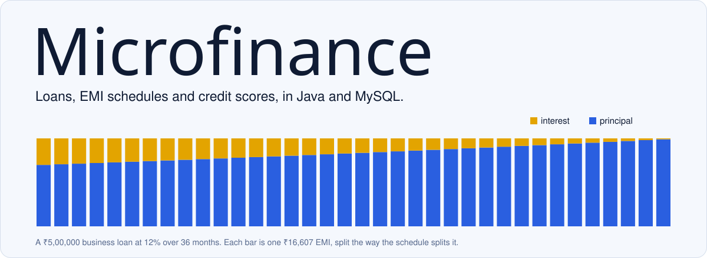

<picture>
  <source media="(prefers-color-scheme: dark)" srcset="docs/readme/banner-dark.svg">
  
</picture>

A loan management system for a small microfinance lender, built in Java with MySQL over JDBC. Borrowers apply for loans. An admin approves them, and approval generates the full EMI schedule. Every payment, and every missed one, moves the borrower's credit score.

## What it does

- **Three loan products with different pricing.** A business loan charges the stated rate, a personal loan adds 1%, and an education loan takes 0.5% off. Each is a subclass of `Loan` that overrides the EMI calculation.
- **Reducing-balance EMIs.** EMI = P·r·(1+r)ⁿ / ((1+r)ⁿ − 1), and the schedule splits each instalment into interest and principal as the balance falls. That's the chart above.
- **Credit scoring.** Everyone starts at 700. A payment adds 5, a missed EMI takes 10, and repaying a loan in full adds 20. Three missed EMIs on any active loan flag the borrower as a defaulter.
- **Two roles.** Admins approve loans, record payments and pull reports. Borrowers see their loans, schedules and score.

## Run it

You need JDK 8+ and MySQL.

1. Create the database: `mysql -u root -p < setup.sql`
2. Set your MySQL password in `src/main/java/com/microfinance/config/DBConnection.java`.
3. On Windows, run `build.bat`. It downloads the MySQL JDBC driver, compiles and starts the app. Anywhere else, run `mvn compile exec:java`.

`setup.sql` creates a demo admin, `admin@microfinance.com` with the password `admin123`. Passwords are stored in plain text because this is a coursework demo, so don't reuse it for anything real.

## How it's built

```
ui/        console menus for admins and borrowers
service/   EMI maths, credit scoring, loan workflow, reports
dao/       one class per table, all SQL lives here
model/     Loan and its three subclasses, Borrower, EMISchedule, Repayment
config/    the JDBC connection
```

Each layer only talks to the one below it, so the menus never touch SQL and the DAOs never make decisions. The full project report, with the schema and design, is in [project.md](project.md).
