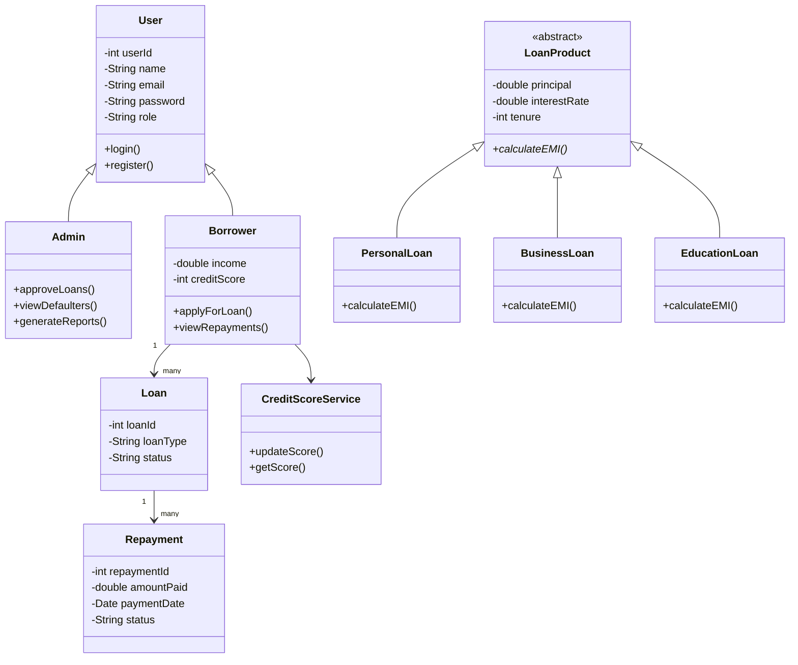

# 🏦 Microfinance & Loan Management System

> **A full-stack Java application for managing loans, EMI schedules, repayment tracking, and credit evaluation — powered by MySQL via JDBC.**

---

## 📋 Title Page

| Field | Details |
|---|---|
| **Project Title** | Microfinance & Loan Management System |
| **Language** | Java |
| **Database** | MySQL |
| **Technologies** | JDBC, OOP Concepts |
| **Student Name** | Arjun Nair |
| **Submission Date** | 15 April 2026 |

---

## 📌 Problem Statement

Traditional microfinance operations are plagued by manual record-keeping, error-prone EMI calculations, and inconsistent repayment tracking. This project addresses those gaps by designing and developing a **Microfinance & Loan Management System** that provides:

- Streamlined loan application and approval workflows
- Dynamic EMI schedule generation and repayment monitoring
- Automated credit score evaluation based on financial behavior
- Role-based access for both administrators and borrowers

The system is implemented in **Java** using **Object-Oriented Programming** principles with **MySQL** as the persistent data store, interfaced via **JDBC**.

---

## 🎯 Objectives

- ✅ Implement core **OOP concepts** (Encapsulation, Inheritance, Abstraction, Polymorphism)
- ✅ Design a modular system using **layered architecture**
- ✅ Perform full **CRUD operations** using JDBC
- ✅ Simulate **real-world loan processing workflows**
- ✅ Dynamically calculate **EMI** based on loan parameters
- ✅ Track repayments and **automatically identify defaulters**
- ✅ Compute **credit scores** based on payment behavior
- ✅ Maintain persistent data using a **relational database**

---

## 🏗️ System Architecture

The application follows a clean **4-Layer Architecture**:

```
┌─────────────────────────────────────────────────────────┐
│                   Presentation Layer                    │
│         Console Menu  /  JavaFX GUI Interface           │
├─────────────────────────────────────────────────────────┤
│                 Business Logic Layer                    │
│    EMI Engine · Loan Approval · Credit Scoring ·        │
│    Defaulter Detection · Report Generation              │
├─────────────────────────────────────────────────────────┤
│              Data Access Layer  (DAO)                   │
│     UserDAO · LoanDAO · RepaymentDAO · BorrowerDAO      │
├─────────────────────────────────────────────────────────┤
│                   Database Layer                        │
│   MySQL — Users · Borrowers · Loans · Repayments ·     │
│            EMI_Schedule                                 │
└─────────────────────────────────────────────────────────┘
```

---

## ⚙️ System Features

### 5.1 — User Management

| Feature | Description |
|---|---|
| Registration | Create borrower or admin accounts |
| Authentication | Secure login with hashed credentials |
| Access Control | Role-based permissions (Admin / Borrower) |
| Profile Management | View & update user profile |
| Account Deletion | Remove user records from the system |

> **OOP Concepts:** Encapsulation · Inheritance · JDBC

---

### 5.2 — Borrower Management

| Feature | Description |
|---|---|
| Add Borrower | Register borrower with income and personal details |
| View Profile | Retrieve full borrower record |
| Update Info | Modify borrower data |
| Delete Record | Remove borrower from the system |

> **OOP Concepts:** Encapsulation · DAO Pattern · Collections

---

### 5.3 — Loan Management

| Feature | Description |
|---|---|
| Apply for Loan | Borrower submits application with loan parameters |
| Loan Types | Personal · Business · Education |
| Admin Approval | Admin can approve or reject pending applications |
| Status Tracking | Monitor loan status: `Pending` → `Approved` / `Rejected` |

> **OOP Concepts:** Abstraction · Inheritance · Polymorphism

---

### 5.4 — Loan Types *(Abstraction)*

```
LoanProduct  (Abstract Class)
│
├── PersonalLoan   → overrides calculateEMI()
├── BusinessLoan   → overrides calculateEMI()
└── EducationLoan  → overrides calculateEMI()
```

Each subclass provides its own EMI calculation logic by overriding the abstract `calculateEMI()` method defined in `LoanProduct`.

---

### 5.5 — EMI Calculation Engine

The engine supports **method overloading** to handle varying input scenarios:

```java
// Overloaded EMI Calculation Methods
double calculateEMI(double principal);
double calculateEMI(double principal, double rate);
double calculateEMI(double principal, double rate, int tenure);
```

**Formula Used:**

```
EMI = [P × R × (1 + R)^N] / [(1 + R)^N − 1]

Where:
  P = Principal Loan Amount
  R = Monthly Interest Rate (Annual Rate / 12 / 100)
  N = Loan Tenure in Months
```

> **OOP Concepts:** Polymorphism (Overloading & Overriding)

---

### 5.6 — EMI Schedule Management

- Automatically generates a full installment schedule upon loan approval
- Each entry tracks:
  - **Due Date**
  - **EMI Amount**
  - **Status** — `Paid` / `Pending`

> **OOP Concepts:** Aggregation · Database Relationships

---

### 5.7 — Repayment Tracking

- Record individual EMI payments against the schedule
- Maintain a full chronological **payment history**
- Identify and list all **outstanding installments**

> **OOP Concepts:** Collections · DAO Pattern · JDBC

---

### 5.8 — Credit Score Calculation

Credit scores are dynamically computed based on borrower financial behavior:

| Event | Score Impact |
|---|---|
| Starting Score | **700** |
| Successful EMI Payment | **+5** |
| Missed EMI | **−10** |
| Loan Fully Repaid | **+20** |

> **OOP Concepts:** Business Logic Layer, Service Pattern

---

### 5.9 — Defaulter Detection

```
IF  missed_EMIs  >  threshold
THEN  mark borrower as DEFAULTER
```

- Automatically flags borrowers who exceed the missed payment threshold
- Generates a real-time **defaulter list** for admin review

---

### 5.10 — Search & Filter

| Filter Option | Description |
|---|---|
| By Borrower Name | Full-text search on borrower name |
| By Loan Type | Filter by Personal / Business / Education |
| By Loan Status | Filter by Pending / Approved / Rejected / Defaulted |

> **OOP Concepts:** SQL Queries · Collections

---

### 5.11 — Admin Dashboard

| Action | Description |
|---|---|
| View Applications | See all submitted loan requests |
| Approve / Reject | Change loan status in real time |
| View Borrowers | Full borrower registry |
| Defaulter Report | List of flagged defaulters |
| Generate Reports | Financial summaries and analytics |

---

### 5.12 — Report Generation

| Report | Description |
|---|---|
| Total Loans Issued | Count and cumulative loan amount disbursed |
| Repayments Collected | Total EMI received to date |
| Defaulter List | All borrowers flagged as defaulters |
| Loan Distribution | Breakdown by loan type (Personal / Business / Education) |

> **OOP Concepts:** SQL Aggregation Functions (`SUM`, `COUNT`, `GROUP BY`)

---

## 🧬 Object-Oriented Design

### Class Hierarchy



---

### OOP Concepts Summary

| Concept | Implementation |
|---|---|
| **Encapsulation** | All fields declared `private` with public getters/setters |
| **Inheritance** | `User → Admin`, `User → Borrower`, `LoanProduct → *Loan` |
| **Abstraction** | `LoanProduct` abstract class with abstract `calculateEMI()` |
| **Polymorphism** | Method overloading (`calculateEMI`) & overriding (subclasses) |
| **Constructors** | Parameterized constructors across all model classes |
| **Collections** | `ArrayList` for loan lists, `HashMap` for schedule mapping |

---

## 🗄️ Database Design

### Entity Relationship Overview

```
Users ──< Borrowers ──< Loans ──< Repayments
                              └──< EMI_Schedule
```

---

### Table Schemas

#### `users`

| Column | Type | Constraint |
|---|---|---|
| `user_id` | INT | PRIMARY KEY, AUTO_INCREMENT |
| `name` | VARCHAR(100) | NOT NULL |
| `email` | VARCHAR(150) | UNIQUE, NOT NULL |
| `password` | VARCHAR(255) | NOT NULL |
| `role` | ENUM('admin','borrower') | NOT NULL |

---

#### `borrowers`

| Column | Type | Constraint |
|---|---|---|
| `borrower_id` | INT | PRIMARY KEY, AUTO_INCREMENT |
| `user_id` | INT | FOREIGN KEY → users(user_id) |
| `income` | DECIMAL(15,2) | NOT NULL |
| `credit_score` | INT | DEFAULT 700 |

---

#### `loans`

| Column | Type | Constraint |
|---|---|---|
| `loan_id` | INT | PRIMARY KEY, AUTO_INCREMENT |
| `borrower_id` | INT | FOREIGN KEY → borrowers(borrower_id) |
| `loan_type` | ENUM('Personal','Business','Education') | NOT NULL |
| `amount` | DECIMAL(15,2) | NOT NULL |
| `interest_rate` | DECIMAL(5,2) | NOT NULL |
| `tenure` | INT | NOT NULL (months) |
| `status` | ENUM('Pending','Approved','Rejected') | DEFAULT 'Pending' |

---

#### `repayments`

| Column | Type | Constraint |
|---|---|---|
| `repayment_id` | INT | PRIMARY KEY, AUTO_INCREMENT |
| `loan_id` | INT | FOREIGN KEY → loans(loan_id) |
| `amount_paid` | DECIMAL(15,2) | NOT NULL |
| `payment_date` | DATE | NOT NULL |
| `status` | ENUM('Paid','Pending') | NOT NULL |

---

#### `emi_schedule`

| Column | Type | Constraint |
|---|---|---|
| `emi_id` | INT | PRIMARY KEY, AUTO_INCREMENT |
| `loan_id` | INT | FOREIGN KEY → loans(loan_id) |
| `due_date` | DATE | NOT NULL |
| `amount` | DECIMAL(15,2) | NOT NULL |
| `status` | ENUM('Paid','Pending') | DEFAULT 'Pending' |

---

## 🔁 CRUD Operations

| Operation | Description | Example |
|---|---|---|
| **Create** | Insert new records | Register user, submit loan application |
| **Read** | Fetch existing data | View borrower profile, list all loans |
| **Update** | Modify records | Approve loan, record EMI payment |
| **Delete** | Remove records | Delete user account, close loan |

---

## 🛡️ Exception Handling

| Exception Type | Handling Strategy |
|---|---|
| Invalid Input | Input validation before processing |
| DB Connection Error | `try-catch` with meaningful error messages |
| `SQLException` | Caught and logged with rollback on failure |
| Negative / Zero Values | Validated at the business logic layer |
| Duplicate Email | Handled via UNIQUE constraint + user feedback |

---

## ✅ Validation Rules

| Field | Rule |
|---|---|
| Loan Amount | Must be > ₹0 |
| Interest Rate | Must be within `0.1% – 36%` |
| Tenure | Must be a positive integer (in months) |
| Email | Must match standard email format |
| Password | Minimum 8 characters |
| Income | Must be > ₹0 |

---

## 🖥️ User Interface

### Option A — Console Interface

```
============================================
    MICROFINANCE & LOAN MANAGEMENT SYSTEM
============================================
  [1] Login
  [2] Register
  [3] Exit
--------------------------------------------
Enter your choice: _
```

### Option B — JavaFX GUI

| Screen | Description |
|---|---|
| Login Screen | Role-aware login for Admin and Borrower |
| Borrower Dashboard | Apply for loans, view EMI schedule, repayment history |
| Admin Panel | Manage applications, view reports, flag defaulters |
| Loan Application Form | Input loan type, amount, interest rate, tenure |
| EMI Tracker | Visual payment calendar with status indicators |

---

## 🔮 Future Enhancements

| Enhancement | Description |
|---|---|
| 🌐 REST API | Expose system functionality via HTTP endpoints (Spring Boot) |
| 📊 Advanced Analytics | Visual dashboard with charts and financial trends |
| 📱 Mobile App | Android/iOS client application |
| 🔔 EMI Reminders | Automated push/email notifications before due dates |
| 🤖 AI Credit Scoring | ML model for predictive creditworthiness evaluation |

---

## 📝 Conclusion

The **Microfinance & Loan Management System** successfully demonstrates the implementation of core Java programming concepts within a real-world financial domain. Through a clean layered architecture, the system handles the complete loan lifecycle — from application and approval to EMI scheduling, repayment tracking, and automated credit evaluation.

By integrating **JDBC** with **MySQL**, the system ensures data persistence with relational integrity. The use of **OOP principles** (Encapsulation, Inheritance, Abstraction, and Polymorphism) results in a maintainable, extensible codebase that can be further developed into a production-grade microfinance platform.

---

*Submitted by **Arjun Nair** | 15 April 2026*